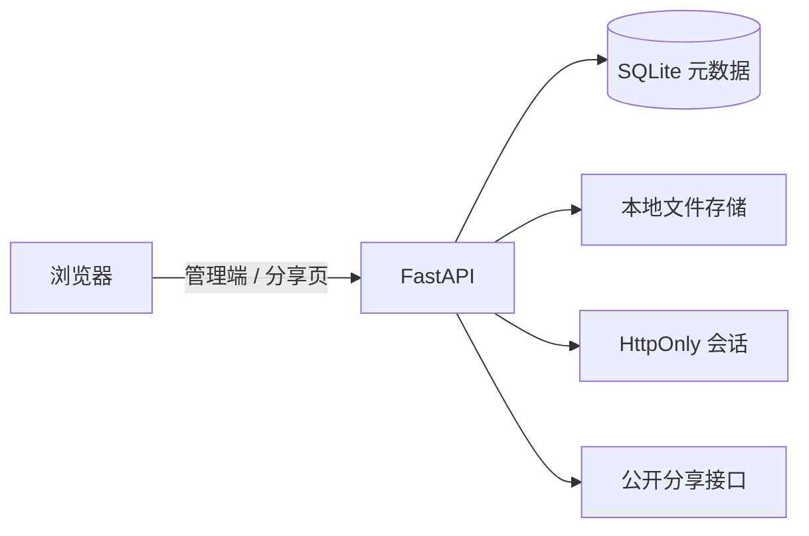

<div align="center">

# CryoVault

**一个专注于本地存储、快速分享和文件预览的轻量级自托管网盘。**

管理端使用令牌保护，文件保存在自己的磁盘上；分组链接和单文件链接可以直接交付给其他人，无需登录。

<br />


</div>

## 目录

- [项目定位](#项目定位)
- [一键部署（推荐）](#一键部署推荐)
- [功能概览](#功能概览)
- [运行架构](#运行架构)
- [快速启动](#快速启动)
- [管理与分享](#管理与分享)
- [配置项](#配置项)
- [开发命令](#开发命令)
- [生产部署](#生产部署)
- [项目结构](#项目结构)
- [后续规划](#后续规划)

## 项目定位

CryoVault 适合以下场景：

- 在家用服务器、NAS 或 Linux 小主机上保存个人文件
- 为一组资料生成一个公开浏览入口
- 临时分享单个文件，不想为了一个文件创建完整目录
- 在浏览器中预览图片、音视频和常见文本文件
- 需要一个简单、可控、数据留在本地的文件交付工具

它不是面向多租户团队协作的企业网盘，当前重点是单管理员、自托管和低维护成本。

## 一键部署（推荐）

适用于支持 `systemd` 的 Linux 服务器。脚本会自动检查运行环境、安装 Python / Node.js 依赖、构建前端、创建独立服务用户、写入配置，并注册 `cryovault.service`。

```bash
bash <(curl -fsSL https://github.com/HlONGlin/CryoVault/raw/main/one-click.sh)
```

脚本会进入交互式管理菜单：

| 选项 | 操作 |
| --- | --- |
| `1` | 安装或更新 CryoVault |
| `2` | 启动服务 |
| `3` | 停止服务 |
| `4` | 卸载并清除全部数据 |
| `5` | 重置管理员令牌，保留文件 |
| `6` | 重新生成管理访问路径 |
| `0` | 退出菜单 |

首次安装时，脚本会让你设置管理员令牌；直接回车则自动生成。安装完成后会打印完整管理地址和令牌，请妥善保存：

```text
管理地址：http://服务器IP:8000/panel/随机路径
管理员令牌：安装时设置或自动生成的令牌
```

脚本默认使用以下路径：

| 内容 | 路径 |
| --- | --- |
| 程序 | `/opt/cryovault` |
| 文件、数据库和配置 | `/var/lib/cryovault` |
| systemd 服务 | `cryovault.service`（以 root 运行，支持网页内一键更新） |

> 卸载操作会删除程序、上传文件、数据库、令牌和配置，并要求输入 `DELETE` 二次确认。重置令牌和重新生成访问路径不会删除文件。

脚本源码位于仓库根目录：[one-click.sh](./one-click.sh)。

## 功能概览

### 文件管理

- 分组保险库：为不同主题建立独立的文件空间
- 直接上传：不创建分组也可以保存并分享文件
- 点击或拖拽上传，支持批量选择
- 上传进度显示与取消上传
- 文件名搜索、类型筛选、名称/大小/修改时间排序
- 网格视图与列表视图，可记住浏览器中的选择
- 图片预览与缩放
- 视频、音频浏览器内播放
- TXT、Markdown、JSON、YAML 和常见代码文件在线查看与编辑
- 单个删除、批量删除、重命名
- 选择多个文件后打包下载 ZIP

### 分享交付

- 分组分享链接：一次分享一个文件空间
- 单文件分享链接：直接交付一个文件
- 分享链接可生成二维码并下载 PNG
- 分享页无需管理员登录
- 文本文件可以按分享权限开启在线编辑
- 可以随时撤销单文件链接，或重新生成分组链接

### 管理与安全

- 管理端使用管理员令牌解锁
- 登录后由 HttpOnly 会话 Cookie 维持状态
- 管理端可以使用随机路径隐藏入口
- 管理 API 与公开分享 API 分开
- 支持登录失败限流
- 支持浅色和深色主题
- 根路径在启用管理路径时默认返回 404

### 在线更新

- 管理员登录后自动检查 GitHub 上的最新版本；有新版时顶栏出现闪烁的「更新 x.y.z」按钮
- 未登录时同样会检查并显示按钮，点击会提示先解锁
- 弹窗内展示当前版本、最新版本、发布说明与更新日志
- 「立即更新」由后端调用已安装的一键脚本 `--update-only` 覆盖升级并重启服务，页面自动刷新
- 「跳过此版本」只在当前浏览器记住该版本，不会再次主动弹出
- 「检查更新」可随时手动重新查询
- 在线更新仅在 Linux + systemd 一键安装的部署中可用；其他部署会显示原因并给出 GitHub 链接

## 运行架构



项目由两个部分组成：

| 部分 | 技术 | 作用 |
| --- | --- | --- |
| 后端 | Python、FastAPI、SQLAlchemy | 鉴权、文件 API、分享 API、静态文件托管 |
| 前端 | React、TypeScript、Vite、Tailwind CSS | 管理控制台、文件预览、分享页面 |
| 数据 | SQLite | 分组、文件元数据、分享令牌 |
| 文件 | 本地目录 | 保存上传文件的实际内容 |

默认数据目录为 `backend/data`，其中包含 SQLite 数据库和 `storage` 文件目录。

## 快速启动

### Linux / macOS

```bash
chmod +x start.sh
./start.sh
```

首次启动会自动：

1. 创建 Python 虚拟环境
2. 安装后端依赖
3. 安装前端依赖
4. 构建前端
5. 生成管理员令牌和管理端路径
6. 启动 FastAPI 服务

启动完成后，终端会显示类似信息：

```text
管理地址：http://127.0.0.1:8000/panel/随机路径
管理员令牌：请使用终端实际显示的令牌
```

启用随机管理路径后，必须使用完整的管理地址。访问 `/` 返回 404 是正常行为。

### Windows 开发环境

后端：

```powershell
cd backend
python -m venv .venv
.\.venv\Scripts\Activate.ps1
pip install -r requirements.txt
$env:CRYOVAULT_ADMIN_TOKEN = "your-test-token"
$env:CRYOVAULT_PANEL_PATH = "/panel/dev"
python -m uvicorn app.main:app --host 127.0.0.1 --port 8000
```

前端另开一个终端：

```powershell
cd frontend
npm install
npm run dev -- --host 0.0.0.0
```

前端开发服务器默认使用 `http://localhost:5173`，并将 `/api` 请求代理到后端。

### 启动脚本参数

```bash
./start.sh 9000          # 使用 9000 端口启动单服务
./start.sh --print-url   # 只打印当前管理地址和管理员令牌
./start.sh --dev         # 启动 Vite + FastAPI 开发模式
./start.sh --help        # 查看帮助
```

## 管理与分享

### 管理员解锁

打开启动脚本打印的管理地址，输入 `CRYOVAULT_ADMIN_TOKEN` 对应的令牌即可解锁。右上角的锁定按钮会注销当前管理会话。

管理端不会把令牌写入 URL。登录失败默认受限流保护，具体次数和窗口可以通过配置项调整。

### 分组分享

1. 创建一个分组。
2. 进入分组并上传文件。
3. 点击分组分享按钮。
4. 复制链接或下载二维码。

### 单文件分享

1. 在管理首页的“直接上传”区域上传文件。
2. 在文件卡片或列表操作区打开分享面板。
3. 复制下载链接或生成二维码。
4. 需要时撤销链接，旧链接会立即失效。

分享页面使用 `/s/<token>`，单文件页面使用 `/f/<token>`。两类公开页面都不需要管理员令牌。

## WebDAV 双向同步

CryoVault 支持通过 WebDAV 与 Nextcloud、坚果云等服务进行双向同步。同步凭据只在后端读取，管理页面不会显示密码。

WebDAV 密码使用数据目录中的 `.webdav-settings.key` 加密；备份时请连同数据目录一起保留该密钥，若丢失则需重新输入密码。

在 `backend/.env` 中配置：

```dotenv
CRYOVAULT_WEBDAV_ENABLED=true
CRYOVAULT_WEBDAV_URL=https://cloud.example.com/remote.php/dav/files/user
CRYOVAULT_WEBDAV_USERNAME=user
CRYOVAULT_WEBDAV_PASSWORD=应用专用密码
CRYOVAULT_WEBDAV_ROOT=/CryoVault
CRYOVAULT_WEBDAV_INTERVAL_SECONDS=900
CRYOVAULT_WEBDAV_CONFLICT_POLICY=keep_both
```

远端文件按 `groups/<分组 ID>/<文件 ID>-<文件名>` 保存。首次同步时，远端和本地同时存在的文件按修改时间决定来源；之后会同步新增、修改、删除和重命名。

冲突策略支持 `keep_both`（保留远端版本为本地冲突副本）、`local_wins` 和 `remote_wins`。管理面板中的 WebDAV 卡片可以测试连接或立即同步；接口为 `GET /api/admin/sync/status`、`POST /api/admin/sync/test` 和 `POST /api/admin/sync/run`。

直链导入位于管理首页“直接上传”区域。系统仅允许从可公开访问的 HTTP/HTTPS 地址下载，并遵守 `CRYOVAULT_MAX_UPLOAD_SIZE` 限制；文件默认进入单文件分享区。

## 配置项

开发模式通常使用 `backend/.env`。所有环境变量均使用 `CRYOVAULT_` 前缀。

| 变量 | 默认值 | 说明 |
| --- | --- | --- |
| `CRYOVAULT_DATA_DIR` | `data` | SQLite 数据库和上传文件目录 |
| `CRYOVAULT_ADMIN_TOKEN` | 空 | 管理员令牌；为空时不要求解锁 |
| `CRYOVAULT_PANEL_PATH` | 空 | 管理端路径，例如 `/panel/abc123` |
| `CRYOVAULT_BASE_URL` | `http://localhost:5173` | 外部系统使用的前端地址 |
| `CRYOVAULT_MAX_UPLOAD_SIZE` | `0` | 单文件上传上限，单位为字节；0 表示不限 |
| `CRYOVAULT_MAX_TEXT_EDIT_SIZE` | `5242880` | 在线编辑器允许处理的最大文本大小 |
| `CRYOVAULT_COOKIE_SECURE` | `false` | 使用 HTTPS 时建议设为 `true` |
| `CRYOVAULT_SESSION_MAX_AGE` | `2592000` | 管理会话最长有效期，单位为秒 |
| `CRYOVAULT_LOGIN_MAX_ATTEMPTS` | `5` | 登录限流窗口内允许的失败次数 |
| `CRYOVAULT_LOGIN_WINDOW_SECONDS` | `300` | 登录限流窗口，单位为秒 |
| `CRYOVAULT_DOCS_ENABLED` | `true` | 是否开放 `/docs` 和 `/openapi.json` |
| `CRYOVAULT_CORS_ORIGINS` | `[]` | 额外允许的跨域来源列表 |
| `CRYOVAULT_TRUST_PROXY_HEADERS` | `false` | 反向代理部署时是否信任转发头 |
| `CRYOVAULT_UPDATE_ENABLED` | `false` | 是否允许在网页内执行在线更新；一键脚本会自动设为 `true` |
| `CRYOVAULT_UPDATE_COMMAND` | 空 | 更新脚本命令，一键脚本写为 `/opt/cryovault/one-click.sh` |
| `CRYOVAULT_INSTALL_DIR` | 自动推断 | 安装目录，用于定位更新脚本和 `VERSION` |
| `CRYOVAULT_UPDATE_REPO` | `HlONGlin/CryoVault` | 检查更新使用的 GitHub 仓库 |
| `CRYOVAULT_UPDATE_BRANCH` | `main` | 没有 GitHub Release 时读取 `VERSION` 的分支 |
| `CRYOVAULT_UPDATE_CHECK_TIMEOUT` | `6` | 访问 GitHub 的超时时间，单位为秒 |
| `CRYOVAULT_GITHUB_TOKEN` | 空 | 可选，用于提高 GitHub API 匿名请求限额 |
| `CRYOVAULT_WEBDAV_ENABLED` | `false` | 是否开启双向 WebDAV 自动同步 |
| `CRYOVAULT_WEBDAV_URL` | 空 | WebDAV 服务地址，例如 Nextcloud 的远程文件地址 |
| `CRYOVAULT_WEBDAV_USERNAME` | 空 | WebDAV 用户名 |
| `CRYOVAULT_WEBDAV_PASSWORD` | 空 | WebDAV 密码或应用密码，仅在服务端环境中设置 |
| `CRYOVAULT_WEBDAV_ROOT` | `/CryoVault` | 远程文件夹根路径 |
| `CRYOVAULT_WEBDAV_INTERVAL_SECONDS` | `900` | 自动同步间隔，单位为秒；设置为 `0` 可关闭调度 |
| `CRYOVAULT_WEBDAV_CONFLICT_POLICY` | `keep_both` | 冲突策略：`keep_both`、`local_wins` 或 `remote_wins` |
| `CRYOVAULT_WEBDAV_VERIFY_TLS` | `true` | 是否验证 WebDAV HTTPS 证书 |
| `CRYOVAULT_WEBDAV_TIMEOUT` | `60` | 单次 WebDAV 请求超时，单位为秒 |
> `CRYOVAULT_UPDATE_COMMAND` 只允许指向安装目录内的脚本，且只接受 `--port`、`--panel-path` 两个参数，脚本必须包含 `--update-only` 入口，避免该配置被用来执行任意命令。在线更新要求 CryoVault 服务以 root 运行（一键脚本生成的 systemd 单元不再指定 `User=`），因为安装过程需要写入 `/opt/cryovault`、安装系统软件包并重启服务。若服务以普通用户运行，更新对话框会直接提示如何修改 systemd 单元；在禁止提权的容器（`no_new_privs`）中请改为在宿主机执行 `sudo bash /opt/cryovault/one-click.sh --update-only`。

生产环境至少应设置：

```dotenv
CRYOVAULT_ADMIN_TOKEN=一段随机长令牌
CRYOVAULT_PANEL_PATH=/panel/一段随机路径
CRYOVAULT_COOKIE_SECURE=true
CRYOVAULT_DOCS_ENABLED=false
```

## 开发命令

构建前端：

```bash
cd frontend
npm install
npm run build
```

只做 TypeScript 检查：

```bash
cd frontend
npm run typecheck
```

运行后端冒烟测试：

```bash
cd backend
source .venv/bin/activate
pip install -r requirements-dev.txt
python smoke_test.py
```

Windows PowerShell 激活虚拟环境时使用：

```powershell
cd backend
.\.venv\Scripts\Activate.ps1
python smoke_test.py
```

## 生产部署

可以让 FastAPI 直接托管 `frontend/dist`：

```bash
cd frontend
npm ci
npm run build

cd ../backend
python3 -m venv .venv
source .venv/bin/activate
pip install -r requirements.txt
python -m uvicorn app.main:app --host 0.0.0.0 --port 8000
```

更适合长期运行的方式是使用 Nginx 或 Caddy 放在前面处理 HTTPS，再将请求转发到 Uvicorn。建议：

- 使用随机、足够长的管理员令牌
- 设置随机 `CRYOVAULT_PANEL_PATH`
- 开启 HTTPS 后设置 `CRYOVAULT_COOKIE_SECURE=true`
- 关闭不需要的 API 文档
- 定期备份 `CRYOVAULT_DATA_DIR`
- 不把 `backend/data` 目录直接暴露给 Web 服务器

一键安装和服务管理请参阅前面的[一键部署](#一键部署推荐)章节。

## 项目结构

```text
CryoVault/
├─ backend/
│  ├─ app/
│  │  ├─ routers/       # 管理、文件、分组和分享 API
│  │  ├─ models.py      # SQLAlchemy 数据模型
│  │  ├─ operations.py  # 文件保存、读取、删除和分享逻辑
│  │  └─ main.py        # FastAPI 应用与静态前端托管
│  └─ smoke_test.py     # 后端冒烟测试
├─ frontend/
│  ├─ src/
│  │  ├─ components/    # 文件浏览器、分享面板、预览和编辑器
│  │  ├─ pages/         # 管理页、分组页和公开分享页
│  │  └─ api.ts         # 前端 API 客户端
│  └─ public/assets/    # favicon 等静态资源
├─ start.sh             # 构建并启动脚本
└─ one-click.sh         # Linux 一键安装与管理脚本
```

## 后续规划

当前版本已经覆盖个人网盘的基础闭环。后续可以继续加入：

- 分组内嵌套文件夹与文件移动
- 回收站、恢复和自动清理
- 断点续传与大文件分片上传
- 存储配额和磁盘空间提示
- 大文件列表分页或虚拟滚动
- 批量重命名和批量移动
- 多用户、角色和细粒度权限
- 可选的对象存储后端

## 许可证

当前仓库未声明独立许可证。公开发布或二次分发前，请先补充适用的许可证文件。
